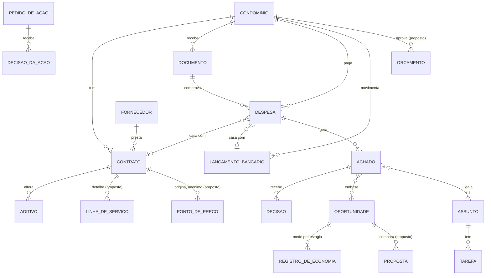
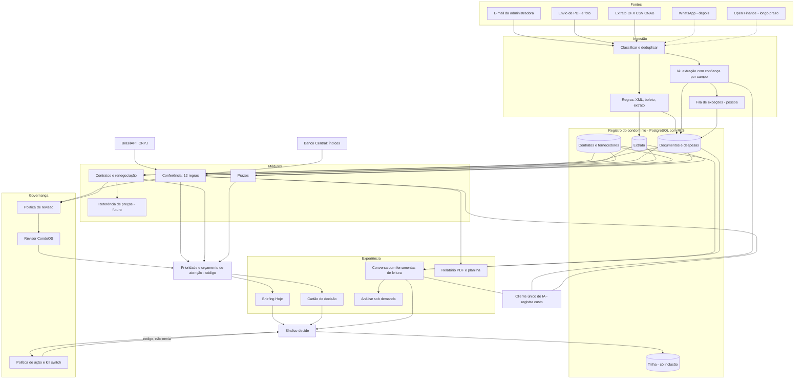

# Reconcepção do CondoOS — Fase 5: capacidades, módulos e arquitetura

Data: 11/11/2026 · Estado: **respondida pelo Marcio em 11/11/2026 (D92)**: módulos confirmados; próxima capacidade é a comparação de propostas; cláusula de preços aceita; dor central é o controle da despesa.

Parte das respostas à Fase 4 (D91): navegação do síndico em quatro destinos como direção; WhatsApp só para resumo e captura de documento, a testar depois dos primeiros clientes; voz adiada, análise sob demanda por componentes fixos e nenhuma autonomia L4 para ação externa.

Marcação: **[FATO]** (aqui, quase sempre fato do repositório, com o caminho do arquivo), **[CÁLCULO]**, **[HIPÓTESE]**, **[PREMISSA]**. Li a lista de tabelas (`api/app/db/models.py`), as regras (`api/app/rules/`), os prompts, a configuração de modelos, a tabela de preços e o resultado do aceite (`docs/pilot/run.md`). Não reli cada módulo linha a linha.

Nenhuma migração, tabela ou módulo foi criado. O que está marcado como *proposto* só entra depois de aprovado, como manda o projeto.

**O que mudou em relação às fases anteriores.** A Fase 2 tratou o custo de IA como desconhecido. A conta da seção 7.4 mostra que ele é pequeno (cerca de R$ 20 por condomínio por mês). **O custo que decide a margem é a revisão humana**, não o modelo. Isso reforça o risco de gargalo de pessoas apontado na Fase 4.

---

## 0. Uma correção de vocabulário antes de começar

O prompt pede "arquitetura multiagentes". O que existe, e o que eu manteria, é outra coisa: **uma esteira determinística com IA em pontos delimitados.**

| Onde | O que decide | Papel da IA |
|------|--------------|-------------|
| Leitura de documento | Regras, XML fiscal, linha digitável; campo abaixo de 0,9 de confiança vai para a fila | Extrai campos quando a regra não alcança |
| 12 regras de conferência (R01–R12) | Código | Só em R04 (escopo) e R07 (CNAE), onde a parte determinística não decide; sem IA ficam "não avaliadas" |
| Explicação do achado | Código confere cada número | Reescreve o texto |
| Economia | Código, método versionado | Nenhum |
| Briefing | Código, a partir de registros | Nenhum |
| Conversa | Ferramentas de leitura; números e citações conferidos por código | **O único agente em sentido próprio** (Claude Agent SDK, 9 ferramentas) |

Para um produto que vende conferência com prova, isso é qualidade, não atraso. Vários agentes negociando entre si acrescentam custo e variação e tiram a possibilidade de refazer a conta. Por isso, abaixo, "módulo" quer dizer capacidade com dono, entradas e saídas, e "orquestrador" quer dizer código de priorização.

---

## 1. Mapa dos agentes do prompt: manter, fundir ou cortar

| Agente proposto no prompt | Veredito | Vira | Motivo |
|---------------------------|----------|------|--------|
| Auditor de Despesas | **Manter** | Módulo Conferência | É a cunha (Fases 1 e 2) |
| Negociador de Contratos | **Fundir** | Módulo Contratos e Renegociação | Prepara, não negocia (D83, D91) |
| Compras e Cotações | **Fundir, reduzido** | Mesmo módulo: pedido de proposta e comparação | Marketplace cortado: receita de fornecedor é vedada (D89) |
| Cobrança e Inadimplência | **Cortar** | — | Fora do alvo; dado pessoal; mercado ocupado |
| Compliance e Manutenção Preventiva | **Reduzir** | Módulo Prazos | Prazos de contrato agora; obrigações legais depois; manutenção de ativos fora |
| Orçamento, Previsão de Caixa e Rateio | **Reduzir e adiar** | Visão "orçado × realizado" dentro da Conferência | Rateio e previsão de caixa são do ERP |
| Comunicação, Assembleia e Atas | **Cortar** | Relatório anual em PDF | Fora da cunha |
| Concierge do Condômino | **Cortar** | — | Chatbot de atendimento é o anti-padrão |
| Orquestrador | **Manter, como código** | Módulo Prioridade | Compõe o briefing e aplica o orçamento de atenção |
| *(novo)* Mão de obra terceirizada | **Acrescentar, a validar** | Pacote de regras da Conferência | 48% da despesa; condição para o retorno ficar forte (Fase 2) |
| *(novo)* Referência de preços | **Acrescentar, longo prazo** | Módulo Referência | Defesa de longo prazo; depende de volume |

De nove agentes ficam seis módulos: **Ingestão, Registro do condomínio, Conferência, Contratos e Renegociação, Prazos, Prioridade**, mais a **Conversa** como forma de acesso e a **Referência de preços** como aposta futura.

---

## 2. Os módulos

### 2.1 Ingestão

| | |
|---|---|
| **Dor** | Dado preso em PDF, e-mail e no sistema da administradora; ninguém digita |
| **Gatilhos** | Arquivo enviado; e-mail recebido no endereço do condomínio; extrato importado |
| **Entradas** | PDF, imagem, XML de NF-e e NFS-e, boleto, `.eml`, OFX, CSV, CNAB 240/400 *(existem)*. Propostas: pasta mensal inteira num só PDF, a separar; documento por WhatsApp (D91, depois); Open Finance (longo prazo) |
| **Método** | Hash do arquivo evita duplicata; classificação; XML e linha digitável por regra; texto por Docling; IA só quando preciso; confiança por campo; origem, página e trecho de cada campo (D85) |
| **Saídas** | Documento estruturado, despesa, lançamento bancário, fila de exceções |
| **Ações** | Nenhuma externa |
| **Autonomia** | Faz e mostra; campo obrigatório incerto vai para pessoa |
| **Métricas** | % de documentos sem revisão manual; erro por campo; tempo da chegada até conferido |
| **Dependências** | Síndico ou administradora entregarem a pasta |
| **Riscos** | **Hoje só 12 de 30 documentos do corpus passam sem revisão, sem chave de API** [FATO, `docs/pilot/run.md`]; a meta de 90% nunca foi medida com o modelo; CNAB não validado com arquivo real; a pasta real de administradora (um PDF de 200 páginas) nunca foi testada |

### 2.2 Registro do condomínio (o "gêmeo digital")

Seção 3.

### 2.3 Conferência

| | |
|---|---|
| **Dor** | Pagamentos aprovados sem conferência contra contrato, nota e extrato |
| **Gatilhos** | Documento ou extrato novo; fechamento do mês; contrato alterado |
| **Entradas** | Despesas, documentos, contratos e aditivos, extrato, cadastro de CNPJ (BrasilAPI), índices (Banco Central), alçadas vigentes |
| **Método** | 12 regras determinísticas: duplicidade, acima do contrato, reajuste, escopo, contrato vencido, fornecedor irregular, CNAE, conflito, pago sem documento, documento sem pagamento, valor fora do padrão, aprovação. Casamento ambíguo vai para pessoa |
| **Saídas** | Achado com valor em risco, evidência e conta; pendências; relatório mensal |
| **Ações** | Nenhuma externa; a pessoa decide (validar, justificar, descartar) |
| **Autonomia** | Faz e mostra; status inicial pela política de revisão (D74) |
| **Métricas** | **Achados confirmados em R$ ÷ despesa total** (a variável H9); precisão (confirmados ÷ apontados); % de pagamentos conferidos; % não conferidos por falta de documento |
| **Dependências** | Ingestão; contratos cadastrados; extrato |
| **Riscos** | Falso positivo desgasta a confiança mais do que a ausência de achado; R04 e R07 só foram testadas com respostas simuladas; sem contrato cadastrado, metade das regras não roda |
| **Extensão proposta** | Pacote **mão de obra terceirizada**: postos e horas contratados × faturados, horas extras, reajuste pela convenção coletiva. Exige guardar a linha de serviço do contrato (seção 3). A validar com contratos reais antes de construir |

### 2.4 Contratos e Renegociação

| | |
|---|---|
| **Dor** | Contrato renovado por inércia; reajuste não questionado; preço sem referência |
| **Gatilhos** | Achado de reajuste ou de valor; aviso prévio se aproximando; pedido do síndico |
| **Entradas** | Contrato, aditivos, cláusulas de aviso, renovação e multa lidas do texto, histórico de faturas, propostas recebidas |
| **Método** | Economia calculada só por código, com método versionado; cinco estágios nunca somados (potencial, estimada validada, aprovada, contratada, realizada); "realizada" medida pelas faturas depois do acordo |
| **Saídas** | Oportunidade revisada; pedido de correção ou de proposta redigido; comparação de propostas *(proposta)*; economia medida |
| **Ações** | Redige; a pessoa envia e registra. O sistema não envia nem negocia |
| **Autonomia** | Recomenda; toda economia passa por revisão interna antes de chegar ao condomínio (D74, D81) |
| **Métricas** | Economia realizada e medida por condomínio por ano; % de oportunidades que viram ação; tempo até a medição |
| **Dependências** | Conferência; revisora CondoOS; o síndico agir |
| **Riscos** | Ciclo longo; economia contestada; sem referência de preço o argumento é só o índice e o histórico; a receita variável de D89 depende deste módulo |

### 2.5 Prazos

| | |
|---|---|
| **Dor** | Vencimento, reajuste, aviso prévio e fim de contrato descobertos tarde |
| **Gatilhos** | Data se aproximando |
| **Entradas** | Datas dos contratos e documentos; propostas: seguro, AVCB, laudos, com cadastro próprio |
| **Método** | Calendário por código; datas previstas marcadas como "previsto" |
| **Saídas** | Item na agenda e no briefing; nunca gera achado |
| **Ações** | Lembrete dentro do app |
| **Autonomia** | Faz e mostra |
| **Métricas** | Prazos avisados com a antecedência combinada; renovações decididas antes do aviso prévio |
| **Dependências** | Datas lidas corretamente |
| **Riscos** | Obrigação legal varia por município e tipo de prédio: cadastro errado dá falsa segurança. Por isso fica para depois |

### 2.6 Prioridade (o "orquestrador")

| | |
|---|---|
| **Dor** | Excesso de avisos; o que importa se perde |
| **Gatilhos** | Qualquer item novo ou alterado; abertura do briefing |
| **Entradas** | Achados, oportunidades, prazos, pedidos de ação, documentos faltantes, preferências da pessoa |
| **Método** | Código: ordena por valor em risco, prazo e certeza; aplica o orçamento de atenção (Fase 4); cada seção do briefing roda isolada e, se falhar, vira "dados parciais" |
| **Saídas** | Briefing do dia; visão de carteira *(proposta para o síndico profissional)*; resumo semanal |
| **Ações** | Nenhuma externa |
| **Autonomia** | Faz e mostra |
| **Métricas** | % de itens do briefing que viram decisão; interrupções por pessoa por semana; itens vencidos sem decisão |
| **Dependências** | Todos os módulos |
| **Riscos** | Peso errado esconde item caro; síndico com oito condomínios precisa de uma ordem única, que ainda não existe |

### 2.7 Conversa

| | |
|---|---|
| **Dor** | Achar informação sem navegar |
| **Gatilhos** | Pergunta da pessoa |
| **Entradas** | 9 ferramentas de leitura; busca híbrida em contratos, convenção e atas |
| **Método** | Agente com ferramentas; o condomínio vem da sessão, nunca do modelo; números, citações e ação sugerida conferidos por código |
| **Saídas** | Resposta com referência; proposta: componente de análise (Fase 4, seção 7) |
| **Ações** | Só leitura |
| **Autonomia** | Responde; não executa |
| **Métricas** | Acerto na avaliação (33 casos; meta de 90% ou mais, zero vazamento entre condomínios) |
| **Dependências** | Chave de API |
| **Riscos** | **A avaliação ao vivo nunca foi rodada** [FATO, pendência do projeto]; termos comerciais do executável embutido a revisar antes do piloto (D54) |

---

## 3. Registro do condomínio: modelo de dados

O banco tem hoje 44 tabelas [FATO]. Agrupadas, com o que eu proporia acrescentar:

| Grupo | Existe | Proposto | Não fazer |
|-------|--------|----------|-----------|
| Condomínio e pessoas | condomínio, usuário, vínculo, papel, corpo diretivo | — | Unidades e moradores: dado pessoal sem uso na cunha |
| Fornecedores e contratos | fornecedor, contrato, aditivo, cláusulas | **Linha de serviço do contrato** (posto, horas, unidade de medida, preço unitário) | — |
| Documentos | documento, versão, proveniência por campo, correção, trechos para busca | — | — |
| Dinheiro | despesa, vínculo com documento, lançamento bancário, aprovação, competência | **Orçamento aprovado** por categoria e ano | Rateio, boletos, cobrança |
| Conferência | achado, política de revisão, decisão, comentário, casamento ambíguo | — | — |
| Economia | oportunidade, revisão, registro de economia por estágio | **Proposta recebida** (para comparar) | — |
| Acompanhamento | assunto, evento, vínculo, tarefa, briefing | **Preferências de atenção** por pessoa | — |
| Ação | pedido de ação, decisão, fila de saída, pausa | — | — |
| Prazos | derivado de contrato e documento | **Obrigação** (tipo, validade, documento), depois | Ativos e equipamentos |
| Referência | índices econômicos | **Ponto de preço** anonimizado (seção 4) | — |
| Controle | trilha de auditoria, chamadas de IA, jobs, versões de configuração | — | — |



A linha de serviço do contrato é a adição mais importante: sem ela não há pacote de mão de obra nem referência de preço comparável.

---

## 4. Referência de preços entre condomínios

**Como construir.** Cada contrato vira um ou mais pontos de preço: categoria (portaria, limpeza, elevadores), unidade de medida (posto de 24 horas, elevador, visita), preço unitário, mês, cidade e zona, porte do condomínio. O condomínio e o fornecedor não fazem parte do ponto.

**Como anonimizar.**

| Regra | Valor proposto [HIPÓTESE] |
|-------|---------------------------|
| Mínimo de condomínios por recorte | 5 |
| Mínimo de fornecedores distintos por recorte | 3 |
| O que se mostra | Faixa (quartis), nunca um preço e nunca a origem |
| Recorte pequeno demais | Sobe um nível (da zona para a cidade) ou não mostra |
| Consentimento | Cláusula no contrato de cada condomínio autorizando o uso anônimo dos preços |

**Como usar.** "Portaria de 24 horas em condomínios de porte parecido na sua cidade: entre R$ X e R$ Y por posto. O seu está em R$ Z." Sempre como faixa, sempre com a data, e só em oportunidade que passou pela revisão interna.

**O problema do começo.** [CÁLCULO] 40 condomínios × 15 contratos = 600 pontos. Espalhados em 12 categorias, 4 zonas e 3 portes, dão cerca de 4 por recorte: abaixo do mínimo. Com três categorias e a cidade inteira como recorte, 40 condomínios dão cerca de 40 pontos por categoria, o que já serve. **Começar por portaria, limpeza e elevadores, em nível de cidade.**

**Como vira defesa.** Cada condomínio novo melhora a faixa para todos; um concorrente novo começa do zero. Os ERPs têm mais contratos, mas guardados como lançamento contábil, sem unidade de medida.

**Riscos.** Contratos com cláusula de confidencialidade [HIPÓTESE jurídica, a conferir]; comparação injusta entre escopos diferentes; faixa lida como "preço certo". Sem consentimento desde o primeiro contrato, a base não pode ser montada depois.

---

## 5. Governança e confiança

| Tema | O que existe [FATO] | Lacuna |
|------|---------------------|--------|
| Segregação entre condomínios | `condominium_id` em toda tabela, filtro na consulta e RLS no banco; outro condomínio responde 404; tentativa registrada | — |
| Papéis | Síndico, conselho, administradora (gerente, analista), Admin e Revisor CondoOS; validar e aprovar em papéis separados | Papel do síndico profissional sobre vários condomínios: verificar se o vínculo múltiplo basta |
| Alçadas | Versionadas, com autor e motivo; as regras usam a versão vigente no mês | Aprovação dupla por valor (Fase 4): conferir se já é coberta |
| Trilha | `decision`, `audit_log`, eventos de assunto, decisões de ação e registros de economia só aceitam inclusão | — |
| Explicação | Evidência, conta e proveniência por campo; número da explicação conferido por código | Levar "o que não foi conferido" ao relatório (Fase 3) |
| Ação externa | Política nega por padrão; pagamento, contratação, multa e dado bancário negados sempre; kill switch; nada é enviado | — |
| LGPD | CPF mascarado, retenção com job diário, exportação auditada, checklist | Base legal e cláusula para a referência de preços; contrato de operador com o condomínio |
| Erro do sistema | Documento revisado por pessoa nunca é reprocessado; achado não mais detectado vira "superado" | **Política pública de erro**: achado descartado conta como erro nosso; correção comunicada; taxa de acerto visível ao cliente |
| Revisão humana | Proporcional ao risco; economia sempre revisada | Capacidade: quantos condomínios por revisor (seção 7.4) |

A governança é a parte mais madura do produto. A lacuna que eu fecharia primeiro é a política de erro, porque é ela que sustenta a promessa de marca.

---

## 6. Camada de experiência: um motor, quatro formas

```
Registros ──► Item tipado ──► Prioridade ──► Forma
              (achado, prazo,   (valor, prazo,   ├─ linha do briefing
               oportunidade,     certeza,        ├─ cartão de decisão
               pedido de ação,   orçamento de    ├─ resultado de ferramenta na conversa
               documento         atenção)        └─ componente de análise
               faltante)
```

O mesmo item, com a mesma evidência e a mesma conta, aparece nas quatro formas. Nenhuma forma tem número próprio: todas leem o registro. A decisão tomada em qualquer forma grava na mesma trilha. É por isso que a navegação pode ser reduzida (Fase 4) sem perda de função.

Estado: briefing, cartão e conversa existem e já leem os mesmos registros. O item tipado comum e o componente de análise são propostas.

---

## 7. Arquitetura técnica de referência

### 7.1 Base

**Manter a que existe** [FATO]: FastAPI com SQLAlchemy assíncrono e Alembic; PostgreSQL 16 com pgvector e RLS; fila de jobs no próprio banco; worker; armazenamento S3; Next.js 15 com TypeScript e Tailwind; cliente único de IA que registra cada chamada. Não vejo motivo para trocar nada. Banco vetorial separado, barramento de eventos ou framework de agentes seriam custo sem cliente que os justifique.

### 7.2 Qual tarefa usa o quê

| Tarefa | Regra | Modelo pequeno | Modelo médio | Modelo grande |
|--------|:-:|:-:|:-:|:-:|
| Ler XML fiscal, boleto, OFX, CNAB | ● | | | |
| Classificar tipo de documento | | ● | | |
| Extrair campos de PDF sem estrutura | | | ● | |
| Casar documento, despesa, extrato e contrato | ● | | | |
| As 12 regras | ● | | | |
| Julgar escopo e CNAE (R04, R07) | | | ● | |
| Calcular economia e reajuste | ● | | | |
| Ler cláusulas de aviso, renovação e multa | ● | | | |
| Reescrever a explicação do achado | | | ● | |
| Montar o briefing e priorizar | ● | | | |
| Conversa com ferramentas | | | | ● |
| Comparar propostas com escopos diferentes *(proposta)* | | | | ● |

Modelos configurados [FATO, `api/app/config.py`]: pequeno `claude-haiku-5-5`, médio `claude-sonnet-5-5` (extração), grande `claude-opus-5-5` (raciocínio).

### 7.3 Memória, avaliação e observação

| Tema | Existe [FATO] | Falta |
|------|---------------|-------|
| Busca | Híbrida: embeddings locais multilíngues e texto completo, só na versão vigente do documento | — |
| Memória | Os registros são a memória; histórico da conversa por condomínio | Preferências de atenção por pessoa |
| Avaliação da extração | Corpus de 30 documentos fictícios com gabarito | **Corpus de documentos reais** (com autorização); medição com o modelo |
| Avaliação das regras | Teste positivo e negativo por regra; casos plantados com resultado exato | Casos reais com decisão do síndico como gabarito |
| Avaliação da conversa | 33 casos | Rodar ao vivo |
| Observação | Tabela de chamadas de IA com custo; métricas internas (precisão, extração automática, revisão, custo); trilha | Painel de custo e de revisão por condomínio |

### 7.4 Custo por condomínio e margem

Preços por milhão de tokens na tabela do repositório [FATO, `api/app/llm/pricing.py`; não conferi com a tabela pública]: pequeno US$ 0,10 e US$ 0,50; médio US$ 2 e US$ 10; grande US$ 4 e US$ 20 (entrada e saída).

Volumes e tamanhos são [PREMISSA]; a medição real sai de `llm_calls` quando houver uso com chave.

| Item, por mês, condomínio de 85 documentos | Conta | US$ |
|--------------------------------------------|-------|:-:|
| Extração de 68 documentos com texto (médio) | 4,5 mil tokens de entrada e 0,5 mil de saída = US$ 0,014 cada | 0,95 |
| Extração de 17 documentos sem texto (médio, arquivo) | cerca de US$ 0,03 cada | 0,51 |
| Classificação (pequeno) | desprezível | 0,03 |
| Julgamento de escopo e CNAE, 20 chamadas (médio) | US$ 0,01 cada | 0,20 |
| Explicação de 5 achados (médio) | US$ 0,008 cada | 0,04 |
| 20 perguntas na conversa (grande) | 15 mil de entrada e 1 mil de saída = US$ 0,08 cada | 1,60 |
| **Total** | | **cerca de 3,30** |

[CÁLCULO] A um câmbio de R$ 5,50 [PREMISSA, não conferido]: **cerca de R$ 18 por mês**. A carga inicial de 12 meses (cerca de mil documentos) custa uns US$ 20, uma vez.

| Margem, a R$ 500 por mês | Cenário atual (40% dos documentos sem revisão) | Meta (90% sem revisão) |
|--------------------------|:-:|:-:|
| IA | R$ 18 | R$ 18 |
| Revisão humana: 2 min por documento revisado + 30 min de validação, a R$ 60/h [PREMISSA] | 51 documentos → 2,2 h → **R$ 132** | 9 documentos → 0,8 h → **R$ 48** |
| Infraestrutura rateada por 40 condomínios [PREMISSA: R$ 800/mês] | R$ 20 | R$ 20 |
| **Custo direto** | **R$ 170** | **R$ 86** |
| **Margem bruta** | **66%** | **83%** |

Leituras:

1. **A IA custa menos de 4% da receita.** Economizar em modelo não muda o negócio.
2. **A revisão humana é o custo e o gargalo.** Um revisor em tempo integral (cerca de 140 horas úteis por mês) atende uns 60 condomínios no cenário atual e uns 170 na meta [CÁLCULO].
3. **A taxa de extração sem revisão é o indicador técnico mais importante**, e ela nunca foi medida com o modelo (pendência do projeto). Meta de margem bruta: 75% ou mais, o que pede cerca de 75% de documentos sem revisão.
4. O primeiro mês de cada condomínio custa várias vezes mais (mil documentos de histórico): o diagnóstico de entrada gratuito tem custo real de algumas horas de revisor.

### 7.5 Diagrama



---

## 8. Fechamento da Fase 5

### Resumo

- **Esteira determinística com IA em pontos delimitados, não "multiagentes".** O único agente em sentido próprio é a conversa. Para um produto de conferência com prova, é a arquitetura certa, e ela já existe.
- **Dos nove agentes do prompt ficam seis módulos**: Ingestão, Registro, Conferência, Contratos e Renegociação, Prazos e Prioridade. Cobrança, concierge, assembleia, manutenção de ativos e marketplace saem.
- **Duas adições de dados sustentam a expansão**: a linha de serviço do contrato (para mão de obra e para comparar preços) e o ponto de preço anônimo.
- **A IA custa cerca de R$ 18 por condomínio por mês; a revisão humana, de R$ 48 a R$ 132.** Margem bruta de 66% hoje e 83% na meta, com as premissas declaradas. O gargalo é gente.
- **A taxa de documentos lidos sem revisão é o indicador técnico que decide margem e escala**, e nunca foi medida com o modelo nem com documento real.

### Três decisões que preciso de você

1. **Mapa de módulos:** confirma os cortes (cobrança, concierge do condômino, assembleia e atas, manutenção de ativos, marketplace de compras) e as fusões da seção 1?
2. **Próxima capacidade depois da carteira do síndico profissional:** eu validaria o pacote de **mão de obra terceirizada** com contratos reais antes de qualquer outra coisa, porque é o que torna o retorno forte (Fase 2). Alternativas: comparação de propostas, ou obrigações legais. Qual prefere?
3. **Referência de preços:** aceita incluir, já nos contratos dos primeiros condomínios, a cláusula que autoriza o uso anônimo dos preços? Custa pouco agora e não dá para obter depois. Precisa de redação por advogado.

### Principais riscos

- **Leitura de documentos reais.** A pasta de uma administradora real pode se comportar muito pior que o corpus fictício; isso muda margem e prazo de entrega.
- **Escala limitada por revisores.** Sem subir a taxa de leitura automática, cada 60 condomínios pedem uma pessoa.
- **Pacote de mão de obra sem dado.** Se o contrato não detalha postos e horas, ou a fatura vem em valor único, a regra não tem o que conferir.
- **Referência de preços que não fecha o mínimo** por muito tempo, ou barrada por confidencialidade.
- **Premissas de custo não medidas.** Volumes de tokens, minutos de revisão e câmbio são suposições; a margem real pode diferir.
- **Dependência de um fornecedor de IA** e dos termos comerciais do executável embutido (D54).

---

## 9. Divergências desta fase

| # | Divergência | Estado |
|---|-------------|--------|
| R16 | "Multiagentes" (prompt) × esteira determinística (código e regras do projeto) | Proposta: manter a esteira. Sem decisão pendente além da 1 |
| R17 | Especificação Mestra prevê Operate (atendimento, manutenção, equipe, incidentes) e Procurement | Esta análise corta ou adia quase tudo de Operate e reduz Procurement a pedido e comparação de propostas. Depende de R1 |
| R18 | Tabelas novas (linha de serviço, orçamento, proposta, ponto de preço, preferências) | Só propostas; nenhuma migração escrita |

**R1 (dor central: coordenação ou controle da despesa) continua aberta desde a Fase 1** e agora tem consequência concreta: R17. Se a resposta for "controle da despesa", o roadmap de Operate da Especificação Mestra deixa de ser o caminho. A Fase 6 precisa dessa resposta.
